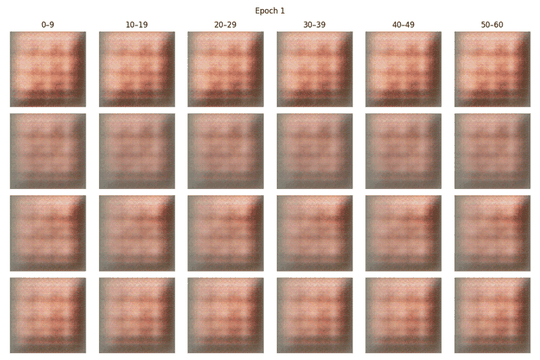

# Age-Conditioned Face Generation with WGAN-GP

This project trains a Wasserstein GAN with gradient penalty to generate 64 × 64 RGB face images. The generator takes random noise and an age group. The critic scores each image together with its age condition.

[Open the notebook](conditional_wgan_gp.ipynb). The notebook includes the saved outputs from the completed run, including dataset previews, duplicate examples, generated faces and evaluation tables.

## Training animation

## Dataset

The dataset is the course-provided FACE dataset in HDF5 format. The HDF5 file is excluded from this repository. Example images are visible in the saved notebook outputs. If you need the prepared file, contact the repository owner about access.

Place the file at `data/UTKFace_64x64.h5`, change `DATA_PATH` in the notebook, or set the `FACE_DATA_PATH` environment variable. A compatible file has the following keys.

| Key                        | Contents                                                     |
| -------------------------- | ------------------------------------------------------------ |
| `images`                   | RGB pixels as a `uint8` array of shape `(N, 3, 64, 64)`      |
| `labels`                   | Ages, one value per image                                    |
| `genders`                  | Gender codes 0–1, one per image                              |
| `races`                    | Ethnic-group codes 0–4, one per image                        |
| `indx_train`, `indx_valid` | Original disjoint partitions whose indices cover the dataset |

The experiment builds its own train, validation and test splits. It keeps exact duplicate images in the same split and filters duplicate groups with missing or conflicting age bands. The original partition keys are read for input checks. Age is the only label used to condition the model.

## Run the notebook

1. Install the dependencies with `python -m pip install -r requirements.txt`.
2. Set the dataset path and open the notebook in JupyterLab or Colab.
3. Run the cells in order from a fresh kernel. A GPU is recommended for training.

The notebook saves checkpoints, generated images and evaluation tables under `results/`. Set `FACE_RESULTS_DIR` to change that location. In Colab, mount Drive separately and use its mounted path if you want the files to persist between sessions.

## Evaluation

Squared Sliced Wasserstein distance selects the model on validation and compares generated and real image sets. A 6 × 6 matrix compares each real age group against every generated condition. The notebook also compares separate real samples and blurred versions of real images to give context to the scores.

| Split      | Images per age group | Mean squared Sliced Wasserstein | SD across projection seeds |
| ---------- | -------------------: | ------------------------------: | -------------------------: |
| Validation |                  100 |                        0.002402 |                   0.000072 |
| Test       |                  100 |                        0.003228 |                   0.000124 |

The recorded run used seed 123 and selected epoch 94. The matching condition gave the lowest distance for all age groups on validation. The pattern was less consistent on test, particularly for ages 40–49 and 50–60. Some generated faces showed blur and distortions.

## References

- [Keras WGAN-GP example](https://keras.io/examples/generative/wgan_gp/)
- [Keras Conditional GAN example](https://keras.io/examples/generative/conditional_gan/)
- [TensorFlow DCGAN tutorial](https://www.tensorflow.org/tutorials/generative/dcgan?hl=pt-br)
- [Émilien Dupont’s WGAN-GP implementation](https://github.com/EmilienDupont/wgan-gp/tree/master)
- The lab's Sliced Wasserstein implementation is credited to Ziqiang Pu in the notebook.
